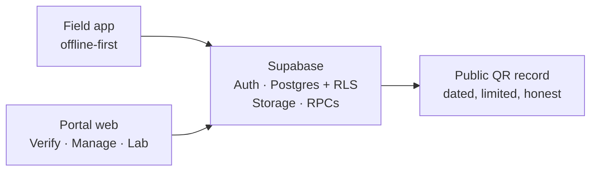

# TankLoop

**TankLoop helps water facilities record concerns, assign someone accountable, verify the fix actually happened, and publish an honest public record - without pretending software can test water or declare it safe.**

Built for the [Xylem Global Student Innovation Challenge 2026](docs/submission/), Water Quality track.

<!-- Live links: portal auto-deploys from main; APK attached to the latest release. -->

## Try it live

| Surface | Link | What it does |
|---|---|---|
| **Portal (web)** | https://tankloop.pages.dev | Verify public records, manage facilities, review lab results - one app, role-based views |
| **Field (Android)** | [Latest release APK](https://github.com/MI-TECHDLIN/tankloop/releases/latest) | Offline-first inspections, sample capture, QR scanning for field staff |
| **Public verify** | https://tankloop.pages.dev/#/point/&lt;token&gt; | Dated water-point record via QR - no account needed |

The portal deploys automatically on every push to `main`. The Android APK is attached to each GitHub release.

## The problem

In facilities that depend on decentralized water systems, information lives in fragments: paper logbooks, WhatsApp messages, staff memory, lab PDFs. The result:

- a leak or contamination concern gets noticed but nobody owns it;
- a repair gets marked "done" with no proof anyone checked;
- residents hear "it's fine" with no date, no evidence, and no way to verify.

TankLoop is an **accountability layer** - it connects those handoffs so every claim has an owner, a timestamp, and evidence behind it.

## How it works

One workflow, five steps:

1. **Inspect** - a field worker logs an observation on a water asset (offline-capable, syncs later)
2. **Sample** - a collector registers a sample; every handoff is a custody event
3. **Review** - an authorized lab records whether the sample was valid and publishes results with full provenance
4. **Respond** - a manager triages the incident, assigns an owner, tracks corrective work
5. **Verify & publish** - a follow-up sample must confirm the fix; only then does a dated public QR record go live

> **Honest by design:** TankLoop is not a sensor, lab, or regulator. It never says water is "safe" - it shows what was checked, when, by whom, and what is still unresolved.

## What makes it different

Most dashboards show green when work is "done." TankLoop refuses to:

- show an inspection as if it were a lab result;
- let a rejected sample close a verification;
- auto-resolve an incident just because a repair was marked complete;
- hide an open concern behind a friendly status;
- publish a record without stating what is missing, outdated, or unverified.

Every correction keeps the old result, the reason, and who changed it. Public records state their own limits.

## Tech stack

- **Flutter + Dart** - one codebase for Android and responsive web
- **Supabase** - Postgres with row-level security, Auth, Storage, RPCs for privileged transitions
- **Riverpod + go_router + Drift/SQLite** - state management, navigation, offline-first local persistence with a sync outbox
- **Monorepo** - shared domain, design system, and data packages across all apps

## Repository layout

```text
tankloop/
  apps/
    field_app/          # Flutter Android app (inspections, QR, evidence)
    portal_web/         # Flutter web app (Verify / Manage / Lab views)
  packages/
    design_system/  domain/  data/  offline_sync/  shared_forms/  localization/
  supabase/
    migrations/      # schema, RLS policies, state machines
    functions/       # privileged transitions, public projections
    tests/           # authorization and RLS checks
  docs/               # architecture, API, development, submission materials
```

## Architecture at a glance



Offline sync path: `local save → outbox → upload → server ack → refresh`. Field work survives dead zones and syncs when connectivity returns.

Core state machines (enforced in SQL, not just UI):

- **Sample result:** collected → received → valid/rejected → tested → reviewed → published → superseded
- **Work order:** proposed → approval → assigned → in progress → completed → accepted/rework
- **Incident:** reported → triaged → assigned → mitigation → verification pending → resolved (reopenable)

See [docs/architecture.md](docs/architecture.md) for the full data model and trust boundaries.

## Honest status

This is a working challenge prototype with a live backend - not a production water-quality service.

- **Live:** portal, Android APK, Supabase backend, public QR verification
- **Real:** auth, RLS tenant isolation, offline sync, audit-preserving corrections
- **Prototype limits:** single deployment, synthetic seed data for demos, no certified lab integrations yet
- **Never:** claims of measured water safety, treatment advice, or regulator functions

## Development

Requires Flutter **3.47.9** (stable).

```sh
flutter pub get

# Portal (web)
(cd apps/portal_web && flutter run -d web-server --web-port 8081)

# Field app
(cd apps/field_app && flutter run --dart-define-from-file=/path/to/.env)
```

Copy `.env.example` to `.env` and fill in Supabase values (`supabase status` after `supabase start` for local dev). Build a release APK with:

```sh
(cd apps/field_app && flutter build apk --release --dart-define-from-file=/path/to/.env.production)
```

See [docs/development.md](docs/development.md) for backend setup, test accounts, and commands.

## Documentation

- [Architecture & data model](docs/architecture.md)
- [API reference](docs/api.md)
- [Field app guide](docs/field-android.md)
- [Lab portal workflow](docs/lab-portal.md)
- [Public verify & QR stickers](docs/public-verify.md)
- [Delivery scope & known limitations](docs/delivery.md)
- [Submission materials](docs/submission/)
