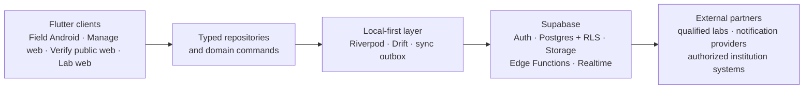
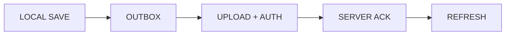
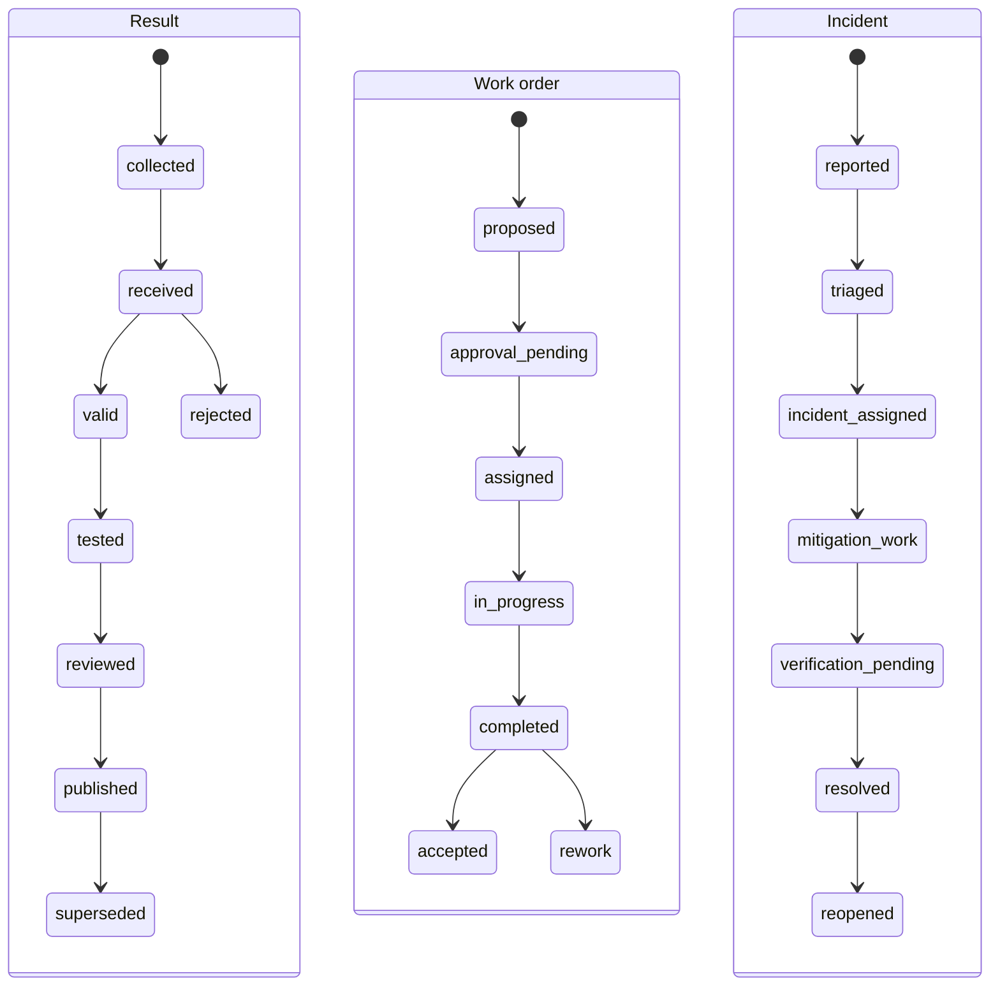
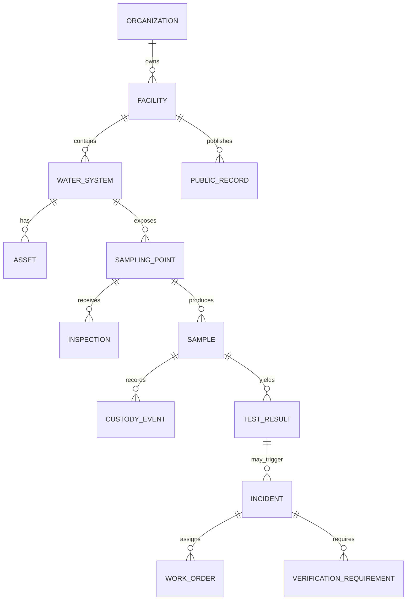
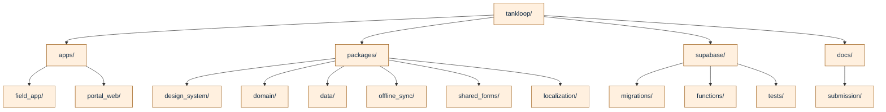

# TankLoop

## From a water concern to an accountable response

TankLoop is a water-quality operations and transparency platform for the **Xylem Global Student Innovation Challenge 2026**, Water Quality track. It helps facilities record concerns, assign accountable action, preserve evidence, verify follow-up, and communicate a dated public status.

<!-- Blueprint p.3–4: TankLoop is an accountability layer, not a sensor or laboratory. -->

In decentralized water systems, information can be fragmented across paper, messaging apps, staff memory, and laboratory reports. A concern may be noticed without a clear owner, a repair may be completed without documented verification, or residents may receive a status without enough context. TankLoop is designed to connect those handoffs.

> **Important:** TankLoop does not sense contamination, replace qualified sampling or testing, provide treatment instructions, or declare water “safe.” All data used in demonstrations is simulated and must be visibly labeled as simulated.

## What TankLoop includes

### Five product surfaces

- **TankLoop Field:** Flutter Android experience for inspections, sample capture, assigned work, evidence, and QR scanning.
- **TankLoop Manage:** responsive workspace for facility managers and administrators to review facilities, incidents, approvals, and reports.
- **TankLoop Verify:** low-data public portal for dated water-point records, open concerns, and resident feedback.
- **TankLoop Lab:** specialist workflow for sample intake, result attestation, evidence review, and corrections.
- **TankLoop Control:** governance tools for onboarding, roles, audit access, and safety controls.

### Seven connected modules

1. Facility and water-network registry
2. Inspections and scheduled maintenance
3. Sampling, custody, and laboratory records
4. Incidents, work orders, and verification
5. Public water records
6. Communication and escalation
7. Reporting, administration, and support

The planned demonstration follows one coherent spine: **inspection → sample → lab result → incident → fix → verified follow-up → public QR record**. Demonstration records are synthetic workflow fixtures, not evidence that real water was tested.

## Trust guardrails

TankLoop keeps evidence source, verification stage, operational concern, and freshness distinct. It is designed so that:

- an inspection is not presented as a laboratory result;
- a rejected sample cannot satisfy verification;
- completed repair does not automatically resolve an incident;
- corrections preserve earlier results, reasons, actors, and timestamps;
- unresolved concerns cannot be hidden behind a friendly status;
- public records state when data is missing, outdated, unverified, or limited in scope;
- private reporter details and unreviewed files stay out of public views; and
- no status says that water is safe.

These are product and governance requirements, not claims that the full system is already deployed or validated.

## Architecture and technology

<!-- Blueprint p.15–16: proposed architecture and monorepo boundaries. -->

TankLoop is planned as a Flutter and Supabase system with typed domain boundaries:

- **Flutter + Dart** for mobile and responsive web experiences
- **Riverpod** for state and dependency injection
- **go_router** for navigation and guarded deep links
- **Drift over SQLite** for relational offline persistence and queued commands
- **Supabase PostgreSQL** for cloud data with tenant-scoped Row Level Security
- **Supabase Auth and Storage** for sessions and access-controlled evidence
- **Edge Functions and constrained RPCs** for privileged transitions, public projections, audit, and notifications

The intended monorepo layout is:

```text
tankloop/
  apps/
    field_app/               # Flutter Android-first experience
    portal_web/              # Flutter Web role-aware experience
  packages/
    design_system/           # tokens, widgets, typography
    domain/                  # entities, states, use cases
    data/                    # repositories and adapters
    offline_sync/            # outbox and conflict resolution
    shared_forms/            # schema-driven inspection forms
    localization/            # language resources
  supabase/
    migrations/              # versioned SQL and RLS policies
    functions/               # privileged transitions and public reads
    tests/                   # authorization and RLS checks
  docs/
    submission/              # public submission materials
```

### Architecture diagrams

The diagrams below describe the **planned** architecture; they do not claim that every surface or integration is already built. See the [full architecture notes](docs/architecture.md) for boundaries, state machines, and data model detail.











## Project status and roadmap

This repository is an active challenge prototype and design proposal, not a production water-quality service. The current priority is a dependable vertical demonstration with clearly labeled simulated records and explicit trust boundaries.

Planned sequence:

1. Implement and test domain entities, state machines, and transition invariants.
2. Establish the shared design system and inspection forms.
3. Add a local-first data path and offline draft behavior.
4. Build the field inspection and manager incident workflow.
5. Add the public QR record with mandated limitation language.
6. Integrate Supabase authentication, RLS, storage, and privileged transitions.
7. Validate with facilities, qualified laboratories, residents, offline devices, and a paper or messaging baseline.

Real deployment would additionally require operational partners, agreed sampling methods, privacy and retention review, regulatory review, and sustained support. The proposed impact metrics are workflow measures, not a composite water-safety score.

## Challenge context

TankLoop is being prepared for the **Xylem Global Student Innovation Challenge 2026**. The project page, live physical demonstration, and evidence appendix distinguish source-backed context, design decisions, research gates, and simulated records. See [`docs/submission/`](docs/submission/) for the current public-facing materials.

## Getting started

Field and Portal (Verify, Manage and Lab) are runnable with Flutter **3.47.9** (Dart **3.13.7**). From the repository root:

```sh
flutter pub get
```

Run each app in its own terminal:

```sh
(cd apps/field_app && flutter run -d web-server --web-hostname 127.0.0.1 --web-port 8080)
```

```sh
(cd apps/portal_web && flutter run -d web-server --web-hostname 127.0.0.1 --web-port 8081)
```

Open [Field](http://127.0.0.1:8080) and [Verify](http://127.0.0.1:8081). Both start with deterministic simulation seed `20261101`, day `10`. No account or backend is required for this mode. For Android, run `flutter run` from `apps/field_app` with an emulator or device connected.

1. In Field, open **Start inspection**, answer the versioned checklist and save a draft.
2. Reload. The draft, answers and visit notes are retained on the device.
3. Use **Profile > Pause sync**, complete the check and **Queue inspection**. Reload again, then use **Activity > Sync queued inspections** to receive a durable acknowledgement. Pause sync is a session-local exercise control.
4. Use **Cases** to inspect the generated response history and **Profile > Advance 1 day** to progress scheduled inspections, sample results and guarded case transitions.
5. Open Verify for a dated public point record. **Water > Copy public QR link** selects a point; **Advance 1 day** and **Text-first view** are also available in Verify.

Simulation instances reproduce the same baseline but do not share custom Field submissions. **Supabase mode shares Field submissions with the public page**. Follow [local backend setup](docs/development.md#local-supabase) for that path.

Open [Lab](http://127.0.0.1:8081/#/lab) for generated sample, custody and result playback. Connected intake, authorized attestation and immutable corrections use a scoped Lab account and Supabase RPCs; see the [Lab workflow guide](docs/lab-portal.md).

See [development commands and hosted inputs](docs/development.md), [implementation details](docs/implementation.md), and [delivery scope and known limitations](docs/delivery.md) for the current slice.

## Submission materials

- [Public project page](docs/submission/project-page.md)
- [Evidence appendix outline](docs/submission/evidence-appendix.md)
