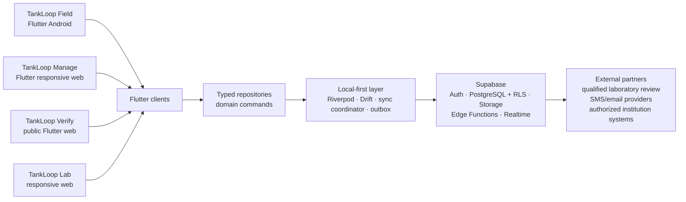
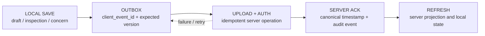
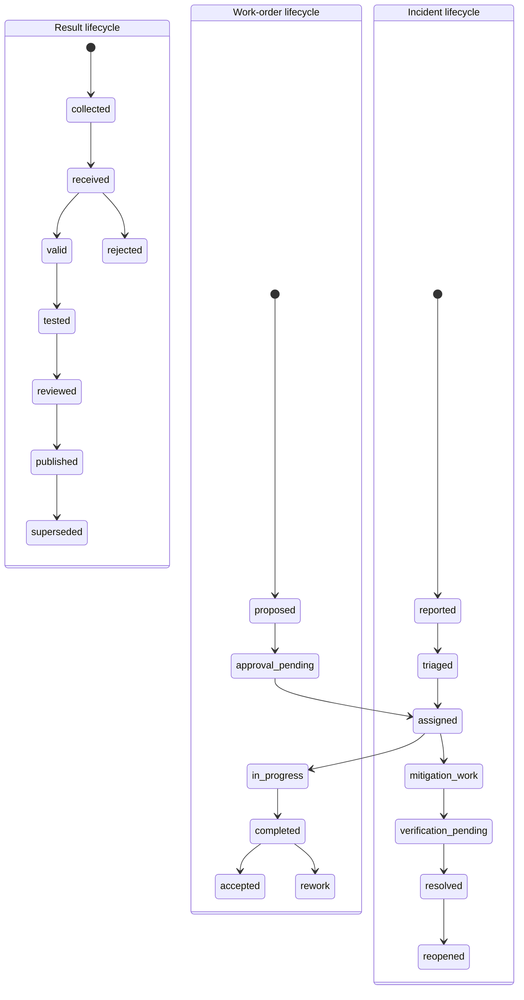
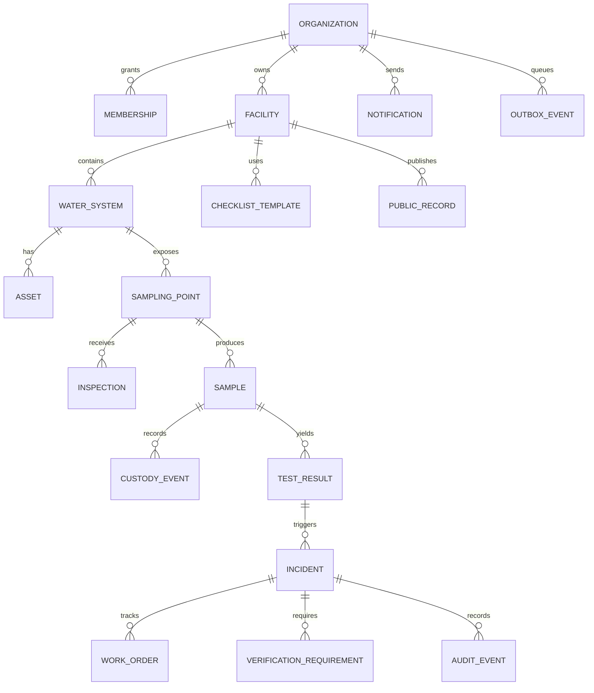
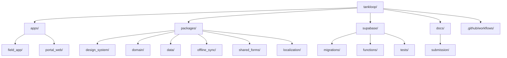

# TankLoop architecture

<!-- Blueprint p.12–18. These diagrams describe the planned design; implementation status is tracked in the repository roadmap. -->

TankLoop is planned as a local-first Flutter and Supabase platform. The diagrams are intentionally limited to the boundaries and invariants needed for the challenge vertical demonstration. A highlighted or described component is not necessarily implemented.

## 1. System architecture

**Planned boundary:** clients use typed use cases and repositories rather than arbitrary table access. Privileged transitions, public projections, audit writes, and notifications belong in Edge Functions or constrained security-definer RPCs. Flutter clients must not contain service-role keys.

## 2. Offline synchronization

Offline drafts, inspections, photos, and concerns are candidates for local persistence. Lab attestation, public publication, membership changes, and incident closure require the server. Scientific results, authority assignments, and closure do not use client-side last-write-wins.

## 3. Separate state machines

The result, work-order, and incident lifecycles are separate. In particular, completing a work order does not resolve an incident.

Resolution requires the configured checklist and sample requirements, an appropriately reviewed result, reviewer authorization, and recorded communication. A repeat verified finding can reopen an incident.

## 4. Simplified data model

Stable identifiers, tenant-scoped access, distinct collected/tested/reviewed/published timestamps, immutable observations, and revision lineage are planned data-quality requirements.

## 5. Planned monorepo layout

The current repository may contain only part of this planned layout. The diagram is a target boundary, not an inventory of completed implementation.

## First-slice implementation

The runnable Field/Verify slice now has [implementation notes](implementation.md) covering its package boundaries, lifecycle guards, tenant/public projection and durable outbox. See [delivery scope](delivery.md) for completed checks and deferred interfaces, and [development setup](development.md) to run it.
